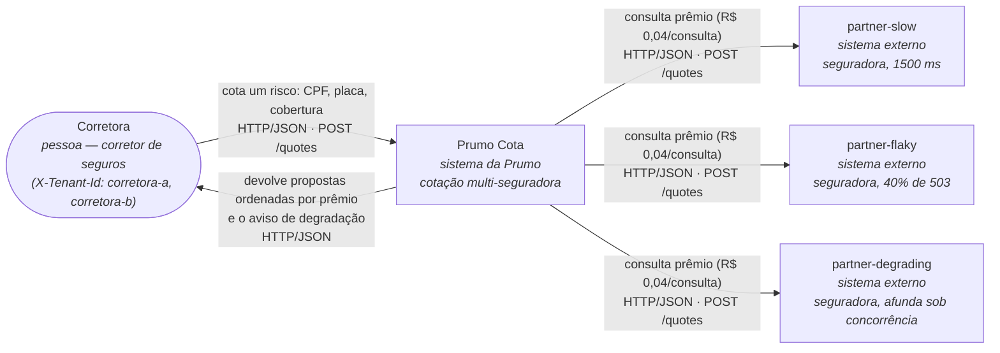
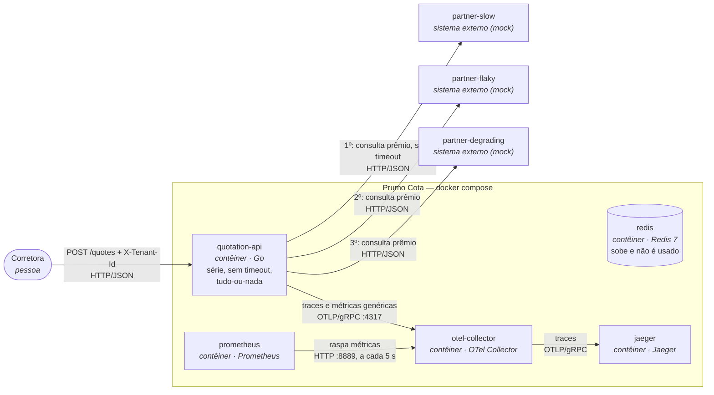
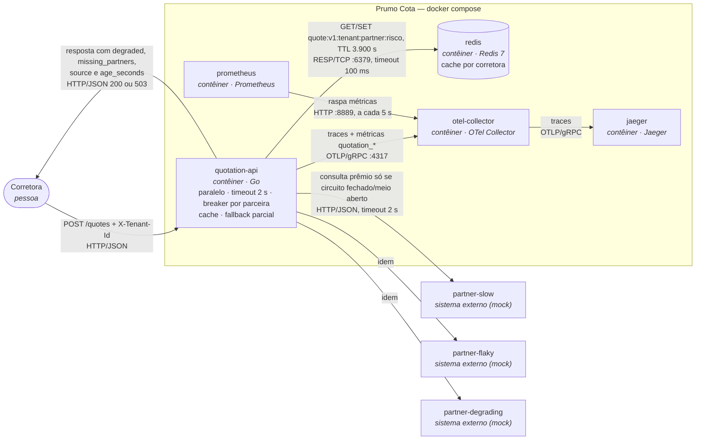
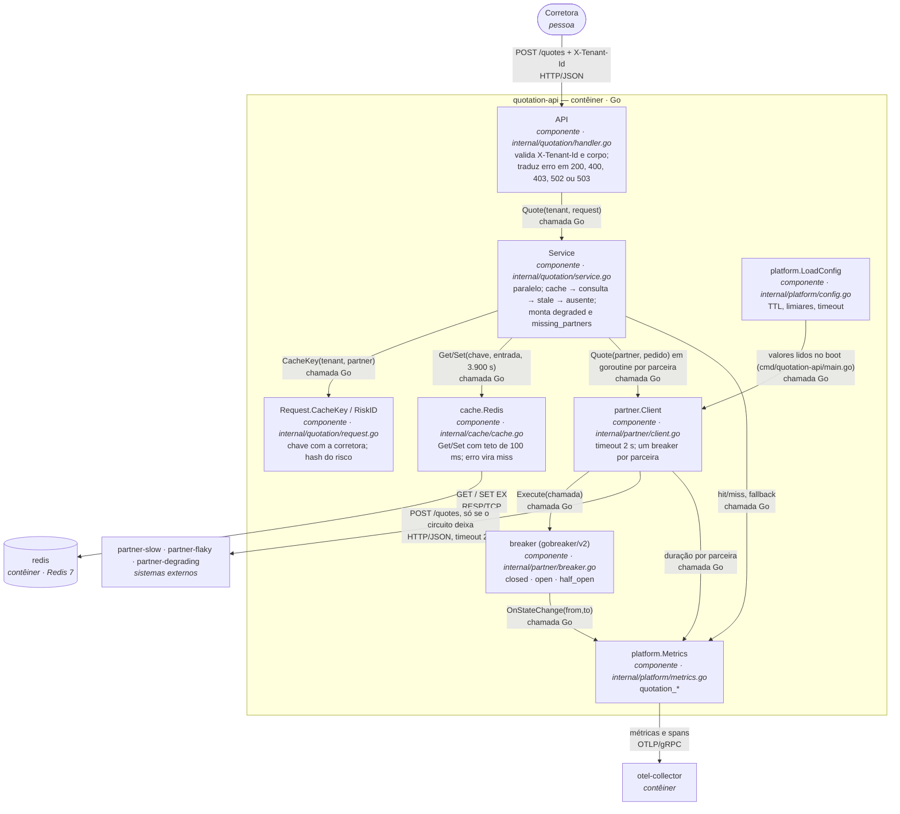

# SAD — Prumo Cota: proteção da fronteira com as seguradoras parceiras

Solution Architecture Document da plataforma **depois** da intervenção. Leitores: o **CTO** (aprova o gasto e quer a conta, §8), quem **opera às 3h** (§6 e §7) e o **encarregado de dados** (LGPD/SUSEP: isolamento entre corretoras e rastreabilidade da cotação servida de cache, §4.2 e §8.2).

**Convenções.** *Implementado* = existe no repositório e foi exercitado; *Proposta* = decidido aqui, não construído. Toda medição citada está em [`docs/evidencias/`](evidencias/) e foi feita por mim, na minha máquina (Windows 11 + Docker Desktop, 2026-11-25), com a carga padrão do `make reproduce` (10 de baseline sequencial + 200 com 50 em voo). Latências diferem entre máquinas; o que se compara é o meu "antes" com o meu "depois". O enunciado está em [`docs/enunciado.md`](enunciado.md).

---

## 1. Introdução

### 1.1 Propósito e escopo

Decidir, com número, como a `quotation-api` deixa de ter a disponibilidade igual ao **produto** da disponibilidade de três parceiras instáveis (`partner-slow`, `partner-flaky`, `partner-degrading`), sem pagar a mesma consulta duas vezes (R$ 0,04) e sem nunca mostrar a uma corretora o dado de outra.

**Dentro do escopo:** a `quotation-api` e a sua fronteira com as parceiras (`internal/partner/client.go`, `internal/quotation/service.go`), o cache em Redis, a instrumentação que prova os mecanismos, e a decisão de onde tudo roda. **Fora:** o motor de precificação das seguradoras e o CRM da corretora (a Prumo intermedeia, não precifica); retry com backoff, bulkhead, rate limiting, fila, autenticação e Kubernetes (citados como limites conhecidos em §4.6, não implementados).

### 1.2 Restrições (impostas, não defendidas)

| ID | Restrição | Origem |
|---|---|---|
| C-01 | Go 1.25, Docker Compose v2, Redis como cache, OpenTelemetry → Collector → Jaeger/Prometheus | enunciado, "As regras não negociáveis" |
| C-02 | As três parceiras são mocks e **não podem ser alteradas** (`cmd/partner-mock/`, perfis no `docker-compose.yml`) | enunciado |
| C-03 | Consulta cobrada a **R$ 0,04**, 120.000 cotações/dia útil × 3 parceiras, 22 dias úteis/mês; receita **R$ 0,25 por cotação entregue** | enunciado, "O cenário" |
| C-04 | Teto comercial de **24 h** para reaproveitar uma cotação | enunciado |
| C-05 | SUSEP: toda cotação apresentada é auditável (parceira, prêmio, corretora, instante), retida **5 anos**, não regravável — inclusive a servida de cache ou fallback | enunciado |
| C-06 | LGPD: corretora é controladora, Prumo é operadora; minimização, prazo de descarte, proibido uso cruzado entre corretoras | enunciado |
| C-07 | A chave de cache contém a corretora; prêmio só de parceira ou de cache rastreável | enunciado |

### 1.3 Decisões (minhas, defendidas na §4 e na §5)

TTL do cache **300 s** (+ **3.600 s** de janela `stale` só para fallback); breaker **por parceira**, **5 falhas consecutivas** abrem, **10 s** aberto, **2 sondas** no meio aberto; timeout **2.000 ms** que **conta como falha**; agregação **em paralelo**; fallback **parcial + cotação vencida marcada + recusa explícita**; hospedagem **cloud em região no Brasil** com auditoria em armazenamento WORM.

### 1.4 Pressupostos

| ID | Pressuposto | Valor | Origem | Se for falso |
|---|---|---|---|---|
| P-01 | Taxa de **recotação**: cotações que repetem um risco já cotado **pela mesma corretora nos últimos 5 min** | **30 %** (faixa 20–45 %) | Hipótese de produto, **não medida**; vem da frase "o corretor recota a mesma placa várias vezes na mesma conversa" (enunciado). O 84 % que o `loadgen` mostra é propriedade da carga (5 riscos repetidos), não de produção | Abaixo de ≈ 8 % (hit efetivo ≈ 7 %) o cache **não paga a operação** (§8.4); a decisão passa a ser desligar o cache ou testar TTL maior, e o veredito da §8 vira "não" |
| P-02 | A parceira cobra a consulta **mesmo quando devolve 503 ou estoura timeout** | R$ 0,04 | Contrato "por consulta ao motor de precificação, não por venda" (enunciado) | Se falha não é cobrada, a economia do breaker em falhas é R$ 0; a conta de §8.3 (cenário b) cai, os demais valores não mudam |
| P-03 | Pico de tráfego | **10 req/s** (média 3,3 req/s em 10 h/dia útil × 3) | Estimativa minha a partir de 120.000/dia | Acima de ≈ **41 req/s** (5 chamadas simultâneas ÷ 0,12 s de latência em repouso da `partner-degrading`) a parceira afunda sem bulkhead (limite L-1, §4.6); seria preciso antecipar o limite de concorrência |
| P-04 | Cotação que falha **não é recotada** pelo corretor (receita perdida) | — | Estimativa pessimista da perda atual | Se o corretor insiste e recebe, a receita recuperada pela disponibilidade (§8.4) é menor; **o veredito do cache não depende dela** |
| P-05 | Preços de lista de nuvem e câmbio | **US$ 1 = R$ 5,50** | Estimativa; não consultei calculadora de provedor | Infra é ≈ 1 % do custo de parceira (§8.2): errar 2× não muda nenhum veredito |
| P-06 | A parceira honra o prêmio por `valid_for_seconds` | **300 s** | `PARTNER_QUOTE_TTL_SECONDS` em `cmd/partner-mock/config.go` | Se a parceira honrar 24 h, o TTL pode subir (§4.2) e o hit rate sobe; se honrar menos, o TTL tem de cair junto |
| P-07 | Volume e tamanho do registro de auditoria | volume constante, **1 KB** por cotação apresentada | Estimativa: 3 cotações × ≈ 250 B + metadados | Cresce linear: 2× o tamanho = 2× o armazenamento (§8.2), que segue desprezível frente à parceira |
| P-08 | Cotação com 2 de 3 parceiras **ainda vale** os R$ 0,25 (cobrança "por cotação entregue") | R$ 0,25 | Leitura do enunciado; o contrato com a corretora não está no repositório | Se o contrato exige as três, a resposta parcial não é faturável: o cenário (b) da §7 custa R$ 18.000 em receita, não R$ 0 |

---

## 2. Visão geral da arquitetura

### 2.1 Nível 1 — contexto (igual antes e depois)

A Prumo **intermedeia**: não precifica, não emite apólice. Só o que viaja nas setas muda de risco, não de forma.



### 2.2 Nível 2 — contêineres **antes** (o `docker-compose.yml` original)

Existem oito serviços. O Redis sobe, mas **ninguém fala com ele**; a API consulta as parceiras **em série, sem timeout**, e uma falha vira 502 (`internal/quotation/service.go` e `internal/partner/client.go` originais).



### 2.3 Nível 2 — contêineres **depois** (implementado)

Não há contêiner novo: **o Redis que já existia passa a ser usado** e a `quotation-api` ganha mecanismos internos (§4.4). Mudaram as setas e o que a API faz com elas.



### 2.4 Delta

| | Antes | Depois | Onde |
|---|---|---|---|
| **Acrescenta** | — | timeout 2 s; breaker por parceira (`gobreaker/v2`); cache Redis por (corretora, parceira, risco); resposta degradada; 3 métricas de negócio + 1 de fallback; 2 marcas de trace; agregação em paralelo | `internal/partner/`, `internal/cache/`, `internal/quotation/`, `internal/platform/metrics.go` |
| **Muda de lugar** | Redis ocioso | Redis no caminho da cotação | `cmd/quotation-api/main.go`, `docker-compose.yml` |
| **Muda no contrato** | 200 só com 3 cotações; qualquer falha = 502 | 200 com `degraded`/`missing_partners`/`source`; **503** com `Retry-After` só quando nada pode ser entregue | `internal/quotation/request.go`, `handler.go` |
| **Sai** | série; espera sem fim | série (só como modo legado, para os testes originais) | `internal/quotation/service.go` |
| **Proposta** (não construído) | — | auditoria WORM; alertas (§6); DR em segunda região (§7); invalidação explícita; bulkhead | §4.6, §6, §7 |

**A quem esta arquitetura serve.** Ao CTO: a conta da §8 fecha com payback de ≈ 3,6 meses no caso base. A quem opera: o breaker e o cache dizem em métrica o que estão fazendo (§6). Ao encarregado de dados: a chave tem a corretora, não carrega CPF nem placa, e a cotação servida de cache mantém o `quote_id` da consulta que a originou (§4.2).

---

## 3. Requisitos

### 3.1 Funcionais

| ID | Requisito (frase testável) | Origem | Teste/evidência |
|---|---|---|---|
| RF-01 | `POST /quotes` sem `X-Tenant-Id` responde 400; com corretora fora de `TENANTS`, 403 | contrato existente (`internal/quotation/handler.go`) | `internal/quotation/handler_test.go` |
| RF-02 | A resposta traz as cotações ordenadas por `premium_cents` crescente, inclusive quando degradada | contrato existente (`service.go`) | `TestQuoteAggregatesTheThreePartnersSortedByPremium` |
| RF-03 | Toda cotação apresentada é auditável por 5 anos (parceira, prêmio, corretora, instante, `quote_id`), inclusive de cache/fallback | SUSEP (C-05) | **Proposta** (§4.5, §8.2); o `quote_id` e o prêmio originais já viajam na resposta |
| **RF-04** | A chave de cache contém a corretora: a mesma placa cotada pela A **nunca** é servida à B | **arquitetura** (C-07) | `TestCacheKeyIsolatesBrokers`; `evidencias/redis-chaves-e-ttl.txt` |
| **RF-05** | Resposta incompleta ou vencida carrega `degraded: true`; `missing_partners` lista as ausentes; cada cotação traz `source` (`partner`/`cache`/`stale_cache`) e `age_seconds` | **arquitetura** | `TestFallbackServesStaleAndReportsMissingPartners`; `evidencias/exemplo-resposta-contrato.txt` |
| **RF-06** | Com o circuito de uma parceira **aberto**, nenhuma requisição HTTP sai para ela | **arquitetura** | `TestBreakerOpensAfterConsecutiveFailuresAndStopsCallingThePartner`; `evidencias/trace-breaker-aberto-curto-circuito.json` (0 spans `HTTP POST`) |
| **RF-07** | Sem nenhuma cotação utilizável, a resposta é **503** `{"error":"no partner quote available","degraded":true,"missing_partners":[…]}` com `Retry-After: 10`, distinguível do 502 | **arquitetura** | `TestAllPartnersDownWithoutCacheIsAnExplicitRefusal` |
| **RF-08** | Redis indisponível não derruba a cotação: vira miss | **arquitetura** | `internal/cache/cache.go` (erro ⇒ miss, timeout 100 ms); §7 cenário (a) |
| RF-09 | O prêmio é sempre o de uma parceira ou de cache rastreável (mesmo `quote_id`); a plataforma não calcula valor | enunciado | `TestCacheHitDoesNotCallThePartners` (prêmio igual ao original) |

### 3.2 Não funcionais

| ID | Requisito | Métrica · unidade | **Hoje** (medido) | Alvo | Como medir | Por que este número |
|---|---|---|---|---|---|---|
| RNF-01 | Latência da cotação sob carga | p95 do `POST /quotes`, s | **8,00 s** (carga) · 2,04 s (baseline) — `evidencias/antes-reproduce.txt` | **≤ 2,5 s** (depois medido: **2,11 s** no `loadgen`; 1,99 s no Prometheus) | `loadgen` e `histogram_quantile(0.95, sum by (le)(rate(http_server_request_duration_seconds_bucket{service_name="quotation-api"}[1m])))` | Teto = timeout de 2,0 s + 0,5 s de agregação/Redis/serialização. O piso sem cache é 1,7 s (pior caso da `partner-slow`); abaixo disso só com cache |
| RNF-02 | Taxa de sucesso (HTTP 200) sob carga | % de 200 | **60 %** (carga) · 50 % (baseline) | **≥ 99,5 %** (depois medido: **100 %**, 210/210) | relatório do `loadgen`; `sum(rate(http_server_request_duration_seconds_count{http_response_status_code="200"}[5m])) / sum(rate(http_server_request_duration_seconds_count[5m]))` | Só falha se as três parceiras caírem sem cotação anterior (RF-07). Hoje é o produto das três: 40 % de 503 da `partner-flaky` derrubam 40 % |
| RNF-03 | Vazão | req/s sustentado | **8,0 req/s** (carga; inflada pela fila) | **≥ 20 req/s** (depois: 94 req/s na carga fria) | `loadgen` | 2× o pico P-03 (10 req/s) |
| RNF-04 | Custo: consultas compradas por cotação | consultas/cotação | **3,0** (contrato; medido < 3 sob falha porque a série aborta) | **≤ 2,3** no caso base (3 × (1 − 0,26)) | `quotation_partner_duration_seconds_count` ÷ cotações; hit rate §6 | A planilha da §8 usa exatamente este hit rate |
| RNF-05 | Isolamento entre corretoras | respostas servidas a uma corretora com origem em consulta de outra | **0** (não havia cache) | **0, sempre** | `TestCacheKeyIsolatesBrokers`; varredura de chaves (`evidencias/redis-chaves-e-ttl.txt`) | Incidente de dados pessoais com dever de notificação à ANPD |
| RNF-06 | Isolamento de parceira doente | falhas consecutivas até o circuito abrir; chamadas após aberto | **∞ / não existe** (sem breaker) | **5 falhas; 0 chamadas** enquanto aberto | `quotation_breaker_transitions_total`; trace sem span de saída | §4.1 |
| RNF-07 | Frescor do que é apresentado como atual | idade máxima de uma cotação com `source ≠ stale_cache` | n/a | **≤ 300 s** (= `valid_for_seconds`) | `age_seconds` na resposta | §4.2 |

---

## 4. Detalhamento da arquitetura

### 4.1 Decisão D-1 — Circuit breaker, timeout e agregação paralela

**Contexto.** A `partner-flaky` falha 40 % das vezes (503) e tem uma rajada de **9 falhas consecutivas nas sequências 49 a 57**; a `partner-degrading` nunca falha: soma 300 ms por chamada simultânea acima de 5, até 6.000 ms. Antes, a API esperava sem limite (`http.Client` com `Timeout` zero) e em série; `evidencias/antes-trace-lento-serie.json` mostra 8,05 s com três spans `HTTP POST` colados (1,70 s + 0,20 s + 6,15 s).

**Opções.**
1. *Só timeout.* Limita a espera, mas continua pagando e esperando a parceira morta a cada requisição.
2. **Breaker por parceira + timeout que conta como falha (escolhida).**
3. Breaker por par (parceira, corretora): isolaria uma corretora abusiva, mas multiplica o número de circuitos por centenas de corretoras e cada um precisa de 5 falhas próprias para aprender o que a plataforma já sabe.
4. Breaker global: uma parceira afundando derruba as outras duas. Descartado: o agregador existe justamente para que fornecedores independentes falhem de forma independente.

**Escolha — escopo e parâmetros** (`internal/platform/config.go`, `docker-compose.yml`, `internal/partner/breaker.go`):

| Parâmetro | Valor | Defesa |
|---|---|---|
| Escopo | **um breaker por parceira**, na memória do processo | opção 2; o preço é o limite L-2 (§4.6) |
| Timeout (`PARTNER_TIMEOUT_MS`) | **2.000 ms** | pior caso saudável medido no mock = 1.500 + 200 = **1.700 ms**; 2.000 dá 300 ms (≈ 18 %) de margem para a `partner-slow` nunca estourar sem querer. A `partner-degrading` passa de 2.000 ms quando há ≥ 12 chamadas simultâneas (120 + 300 × (n − 5) > 2.000). Evidência: 13 estouros na carga fria (`quotation_partner_duration_seconds_count{outcome="timeout"}`) |
| **O estouro conta como falha?** | **Sim** | é o que torna a `partner-degrading`, que nunca devolve erro, visível ao contador. Sem isso o breaker jamais abriria para ela |
| Abre com | **5 falhas consecutivas** (erro de transporte, timeout ou 5xx; 4xx não conta) | `make smoke` (`cmd/partner-mock/feasibility_test.go`): 5 consecutivas abrem na requisição 42 em sequência e em 104 sob 34 chamadas simultâneas, ou seja, abrem na rajada 49–57 e não no ruído. **3** abriria 13 vezes em 210 requisições (flapping sobre uma parceira que acerta 60 %); P(3 seguidas) = 6,4 % contra P(5 seguidas) = 1,0 % |
| Tempo aberto (`BREAKER_OPEN_SECONDS`) | **10 s** | cada ciclo aberto→sondas custa 2 × R$ 0,04 = R$ 0,08 por réplica; 10 s limita isso a R$ 345,60 em 6 h para 2 réplicas (§7 cenário b) e coincide com o `Retry-After` do RF-07 |
| Meio aberto (`BREAKER_HALF_OPEN_MAX`) | **2 sondas**; as duas com sucesso fecham, qualquer falha reabre | uma sonda só fecharia por sorte (60 % na `partner-flaky`); duas dão 36 % e limitam o custo de sondar parceira morta a R$ 0,08 |
| Biblioteca | **`github.com/sony/gobreaker/v2` v2.1.0** | expõe os três estados como tipo (`StateClosed/HalfOpen/Open`), `ReadyToTrip` com `ConsecutiveFailures` e `OnStateChange`, que alimenta a métrica. Descartadas: implementação própria (≈ 100 linhas a manter e testar sem ganho); `failsafe-go` (mais superfície que o necessário) |

**Agregação em paralelo (bônus, implementado como decisão).** Contexto: em série o p95 é a **soma** das parceiras. Escolha: `WithParallel` em `internal/quotation/service.go`; a latência vira o **máximo** (≤ 2,0 s por causa do timeout). Consequência ruim: a concorrência sobre cada parceira passa a ser igual ao nº de requisições em voo — a carga fria com 50 em voo mandou 50 chamadas simultâneas à `partner-degrading`, ela estourou o timeout 13 vezes e o breaker dela abriu (§4.6, L-1). Em série essa concorrência existia igualmente (medida: 34 em voo no smoke), mas diluída no tempo.

**Estados visíveis de fora.** `quotation_breaker_state{partner}` (0 closed · 1 half_open · 2 open), `quotation_breaker_transitions_total{partner,from,to}` e, no trace, `partner.quote` com `breaker.short_circuited=true` e **sem** span `HTTP POST` filho (§4.7).

**Consequências.** (+) Parceira morta custa 0 ms e R$ 0 enquanto aberto. (−) Cada réplica aprende sozinha (L-2). (−) O gauge lê o estado no momento da coleta, porque o gobreaker só muda de aberto para meio aberto quando alguém pergunta. (−) Falso positivo: 5 falhas seguidas legítimas de uma parceira 60 % saudável abrem o circuito (observado: `partner-flaky` abriu 1 vez na carga de variação e reabriu 3 vezes em sondas antes de fechar).

### 4.2 Decisão D-2 — Cache

**Contexto.** 360.000 consultas/dia útil (R$ 316.800/mês) e boa parte repetida (P-01). Cache é decisão financeira (§8) e obrigação de isolamento (C-06, C-07).

**Opções.** (a) cache **agregado** (a resposta de 3 parceiras numa chave): economiza mais por hit, mas expira inteiro de uma vez e some se uma parceira estava fora quando foi gravado; (b) **por parceira (escolhida)**: sobrevive a uma parceira fora (serve a vencida só dela) e permite resposta parcial; custa 3 chaves por cotação; (c) cache só no corpo da requisição, sem corretora: **reprovado** (vazamento entre corretoras).

**A chave, por extenso** (`Request.CacheKey` em `internal/quotation/request.go`):

```
quote:v1:{tenant_id}:{partner}:{RiskID}

tenant_id = valor do cabeçalho X-Tenant-Id (nunca do corpo; já validado contra TENANTS)
partner   = nome da parceira (partner-slow | partner-flaky | partner-degrading)
RiskID    = hex( primeiros 16 bytes de SHA-256( JSON de
              [driver.document, driver.birth_year, vehicle.plate,
               lower(vehicle.model), vehicle.year, vehicle.value_cents, coverage] ) )
            calculado depois de Normalize (placa em maiúsculas, textos aparados)
```

Exemplo real (`evidencias/redis-chaves-e-ttl.txt`): `quote:v1:corretora-b:partner-flaky:d42400b44915b8f52c09a18985720fa8`. O `RiskID` é hash para que **CPF e placa nunca apareçam em chave do Redis** (minimização). O valor guardado também não os contém: é a cotação da parceira (`quote_id`, prêmio, validade) e o instante da compra.

**Política completa.**

| Pergunta | Decisão | Defesa |
|---|---|---|
| **TTL fresco** | **300 s** (`CACHE_TTL_SECONDS`) | igual ao `valid_for_seconds` que a parceira devolve (P-06): a plataforma nunca apresenta como atual um preço que a própria parceira já não garante. Teto comercial é 24 h; **não** chego a ele porque a corretora precisa que a cotação exibida seja praticável na hora da venda e o mock só garante 300 s. TTL maior compraria hit rate com prêmio vencido |
| Janela `stale` | **3.600 s** além do TTL (`CACHE_STALE_SECONDS`), **só** quando a parceira falha | total físico **3.900 s ≈ 65 min**, 22× abaixo das 24 h; a config **recusa** subir se `TTL + stale > 86.400` (`TestCacheCannotExceedTheCommercialCeiling`) |
| Breaker aberto ou parceira falhou | serve a entrada vencida **se** idade ≤ TTL + stale; **a corretora fica sabendo**: `source: "stale_cache"`, `age_seconds`, `degraded: true` | opção 2 do enunciado, combinada com a parcial (§4.3) |
| O que invalida antes da hora | **nada além do TTL** (limite L-3). Proposta: `DEL` por corretora/parceira em mudança tarifária | nenhum sinal de repricing existe nas parceiras mock |
| Como somem (LGPD) | o próprio Redis expira a chave aos 3.900 s (`SET … EX`); sem AOF/RDB no compose (efêmero); chave sem dado pessoal em claro | prazo de descarte é propriedade do dado, não de um job. Em produção: persistência desligada ou cifrada e retenção ≤ 3.900 s documentada ao DPO |
| Redis fora/lento | cada operação tem teto de **100 ms** e erro vira **miss** (RF-08) | cache é otimização; não pode ser causa de indisponibilidade |
| Rastreabilidade | a entrada guarda o `quote_id` e o prêmio **da consulta original**; a plataforma só acrescenta `source` e `age_seconds` | RF-09 e C-05 |

**Consequências.** (+) Hit mede-se em PromQL: `sum(rate(quotation_cache_requests_total{result="hit"}[5m])) / sum(rate(quotation_cache_requests_total[5m]))`. (−) Entrada da `partner-flaky` só existe quando a consulta anterior deu certo (60 %): o hit efetivo é ≈ 0,867 × a recotação (§8.1). (−) Duas requisições simultâneas para o mesmo risco podem devolver prêmios diferentes (uma do cache, outra da parceira): **citado, não resolvido** (fora de escopo do enunciado). (−) Sem coalescência de requisições (`singleflight`), a partida a frio gera tempestade de consultas (§4.6, L-1).

### 4.3 Decisão D-3 — Fallback

**Contexto.** Hoje uma parceira falhando devolve 502 e descarta as respostas já recebidas (`antes-trace-erro-502.json`: a `partner-slow` respondeu em 1,6 s e o resultado foi jogado fora).

**Opções.** (1) só **resposta parcial**; (2) só **cotação anterior do cache**; (3) só **recusa**; (4) **combinação em camadas (escolhida)**.

**Escolha.** Por parceira, nesta ordem: cache fresco → consulta → cotação vencida (se a parceira falhou e ainda dentro de TTL + stale) → ausente. Depois: ≥ 1 cotação ⇒ **200**; nenhuma ⇒ **503 explícito**.

**Contrato de resposta** (`Response` em `internal/quotation/request.go`; exemplo real em `evidencias/exemplo-resposta-contrato.txt`):

```jsonc
{
  "tenant_id": "corretora-a",
  "quotes": [{
    "partner": "partner-flaky", "quote_id": "partner-flaky-b9f05666b6c9d15c",
    "premium_cents": 147172, "currency": "BRL", "coverage_cents": 9000000,
    "valid_for_seconds": 300,                       // o da consulta original
    "source": "partner" | "cache" | "stale_cache",  // NOVO: origem do prêmio
    "age_seconds": 1                                // NOVO, omitido se 0: idade da consulta
  }],
  "degraded": false,            // NOVO: true se há parceira ausente OU cotação stale_cache
  "missing_partners": ["partner-flaky"],  // NOVO, omitido se vazio
  "elapsed_ms": 1683
}
```

Mais o cabeçalho `X-Quote-Degraded: true` (só quando `degraded`). `source: "cache"` dentro do TTL **não** é degradação: é a mesma cotação, ainda válida, mais barata. A ordenação por prêmio continua. Sem nenhuma cotação: **503** com `{"error":"no partner quote available","degraded":true,"missing_partners":[…]}` e `Retry-After` derivado de `BREAKER_OPEN_SECONDS` (10 s por padrão: `API.WithRetryAfter`, `TestRetryAfterFollowsTheBreakerOpenTime`); a corretora deve esperar o tempo em aberto do breaker e recotar.

**Consequências.** (+) Disponibilidade deixa de ser o produto das três (RNF-02). (−) A corretora passa a ter de **tratar** `degraded`: um cliente que ignora o campo apresenta uma cotação com uma seguradora a menos, ou vencida, como se fosse completa; por isso o campo é explícito e o 200 não é silencioso (cabeçalho + corpo). (−) Mudança de contrato aditiva: clientes antigos continuam lendo `quotes`. (−) O hit de `stale_cache` apresenta prêmio de até 65 min: cabe à corretora re-validar antes de vender (`age_seconds` > `valid_for_seconds` significa vencido pela regra da própria parceira).

**Auditoria.** A resposta degradada é cotação apresentada e entra na trilha da §4.5 com `source`, `age_seconds` e o `quote_id` original, que liga ao registro da consulta que a originou.

### 4.4 Diagrama C4 nível 3 — a fatia implementada

Componentes dentro da `quotation-api` (implementados; arquivos reais). O Redis e as parceiras são externos ao contêiner.



### 4.5 Rastreabilidade e auditoria (SUSEP) — **proposta**

Não implementei persistência de auditoria (fora de escopo do enunciado). A decisão: **uma linha imutável por cotação apresentada** — `tenant_id`, instante, `trace_id`, e por parceira `partner`, `quote_id`, `premium_cents`, `source`, `age_seconds` — gravada **antes** de a resposta sair (se a gravação falhar, a resposta falha: auditoria é obrigação, cache não), em armazenamento **WORM** (§5.2). **Sem CPF nem placa** (a trilha pedida é parceira/prêmio/corretora/instante; o dado pessoal fica com a controladora). `source`/`age_seconds`/`quote_id` já existem na resposta (D-3) e são o elo "cotação servida de cache → consulta que a originou". Custo: §8.2.

### 4.6 Limites conhecidos (o que **não** resolvo)

| ID | Limite | Gatilho que o expõe | Efeito na corretora |
|---|---|---|---|
| **L-1** | **Sem limite de chamadas simultâneas por parceira** (bulkhead) nem coalescência de requisições idênticas | > 12 chamadas simultâneas à `partner-degrading` (ou > 41 req/s em regime, P-03); **observado**: carga fria com 50 em voo ⇒ 13 timeouts, p95 2,11 s (contra 265 ms na execução anterior da mesma carga), 29 respostas parciais | Latência de ≈ 2 s e resposta sem a `partner-degrading` até o circuito dela fechar |
| **L-2** | **O breaker vive na memória do processo**: não atravessa réplicas nem deploy | Parceira cai com N réplicas ⇒ cada uma gasta 5 falhas (≈ 5 × 2 s no pior caso) para abrir; réplica reiniciada volta **fechada** | Primeiras requisições de cada réplica pagam o timeout; custo de sondagem multiplicado por N (R$ 0,08 × N por ciclo) |
| **L-3** | **O TTL é a única forma de invalidar o cache** | Parceira reprecifica, ou a corretora muda condição comercial, antes de 300 s (ou de 65 min no `stale`) | Prêmio defasado por até 5 min (fresco) — dentro da validade que a parceira declarou; até 65 min só em `stale_cache`, marcado |
| **L-4** | **Uma corretora pode consumir a capacidade das outras**: breaker por parceira (não por corretora), sem cota por `tenant_id` | Corretora X envia riscos todos distintos (zero hit) em volume alto ⇒ derruba a `partner-degrading` | **Todas** as corretoras recebem resposta parcial sem a `partner-degrading`, e o cache delas não ajuda nos riscos novos |
| L-5 | Duas requisições simultâneas, mesma corretora e mesmo risco, podem receber prêmios diferentes (cache vs parceira) | Recotação concorrente no limite do TTL | Dois prêmios para o mesmo risco no mesmo minuto; ambos rastreáveis por `quote_id` |

### 4.7 Instrumentação (como cada afirmação se prova)

| Métrica / marca (Prometheus / Jaeger) | Atributos | Emitida em | Prova |
|---|---|---|---|
| `quotation_breaker_state` (gauge 0/1/2) | `partner` | `internal/platform/metrics.go`, lida no momento da coleta | `evidencias/breaker-estado-no-tempo.png` |
| `quotation_breaker_transitions_total` | `partner`, `from`, `to` | `internal/partner/breaker.go` (`OnStateChange`) | idem (transições `closed→open`, `open→half_open`, `half_open→closed`) |
| `quotation_cache_requests_total` | `tenant_id`, `result` = `hit`/`miss` | `internal/quotation/service.go` | `evidencias/cache-hit-rate.png` |
| `quotation_partner_duration_seconds` (histograma) | `partner`, `outcome` = `ok`/`error`/`timeout` | `internal/partner/client.go` | p95 por parceira; chamadas **curto-circuitadas não entram** (não há chamada) |
| `quotation_fallback_responses_total` | `kind` = `stale_cache`/`partial`/`refused` | `internal/quotation/service.go` | alerta A-3 (§6) |
| Span `partner.quote` | `partner`, `tenant_id`, `cache.result`, `breaker.short_circuited`, `partner.timeout`, `cache.stale_served` | `internal/quotation/service.go` | `evidencias/trace-breaker-aberto-curto-circuito.json` · `trace-servido-de-cache.json` |
| Atributos no span `POST /quotes` | `quote.degraded`, `quote.served_from_cache`, `quote.missing_partners`, `tenant_id` | idem | filtro no Jaeger |

Nenhum atributo de span ou de métrica contém CPF, placa ou `quote_id`; `tenant_id` é o único dado de cliente e entra só no cache (cardinalidade = nº de corretoras, algumas centenas). A latência por parceira **não** reaproveita `http_client_request_duration_seconds`: `quotation_partner_duration_seconds` é a métrica de domínio; a genérica segue disponível (`server_address`).

---

## 5. Implementação

### 5.1 Como se constrói

| Requisito (§3) | Mecanismo (§4) | Arquivo real |
|---|---|---|
| RNF-01, RNF-06 | timeout 2 s | `internal/partner/client.go` (`DefaultTimeout`, `WithTimeout`); `internal/platform/config.go` (`PARTNER_TIMEOUT_MS`) |
| RF-06, RNF-06 | breaker por parceira | `internal/partner/breaker.go` (`newBreaker`, `isHealthy`); `internal/partner/client.go` (`Client.Quote`) |
| RF-04, RNF-05 | chave com a corretora | `internal/quotation/request.go` (`RiskID`, `CacheKey`) |
| RF-08, RNF-04 | cache Redis, erro ⇒ miss | `internal/cache/cache.go`; `internal/quotation/service.go` (`fetch`) |
| RF-05, RF-07 | fallback + contrato | `internal/quotation/service.go` (`Quote`, `UnavailableError`); `internal/quotation/request.go` (`Response`); `internal/quotation/handler.go` |
| RNF-01 | agregação paralela | `internal/quotation/service.go` (`WithParallel`) |
| §6 | métricas e spans | `internal/platform/metrics.go`; `internal/quotation/service.go` |
| §4 | parâmetros | `internal/platform/config.go`; `docker-compose.yml` (serviço `quotation-api`); `cmd/quotation-api/main.go` (ligação) |

Sem nenhuma `Option`, `quotation.NewService` continua sendo o serviço original (série, tudo-ou-nada): é assim que os testes que já vinham (`TestQuoteCallsThePartnersSerially`, `TestOnePartnerDownBringsDownTheWholeRequest`) seguem verdes; `main.go` liga paralelo, cache e fallback.

**Como se testa sem depender de sorte** (padrão de `cmd/partner-mock/feasibility_test.go`: determinístico, sem `sleep` calibrado):

| Comportamento | Teste |
|---|---|
| breaker abre após N falhas e **não chama** a parceira aberto | `internal/partner/breaker_test.go` — `TestBreakerOpensAfterConsecutiveFailuresAndStopsCallingThePartner` (tempo em aberto 1 h; contador do servidor não anda) |
| meio aberto fecha com as sondas e reabre se a sonda falha | `TestBreakerHalfOpenClosesOnProbesAndReopensOnFailure` (espera a **condição**, com teto de 5 s, não um tempo) |
| timeout conta como falha | `TestTimeoutCountsAsFailureForTheBreaker` |
| um breaker por parceira | `TestBreakersAreIndependentPerPartner` |
| hit não chama parceira; isolamento; chave sem PII | `internal/quotation/resilience_test.go` — `TestCacheHitDoesNotCallThePartners`, `TestCacheKeyIsolatesBrokers` |
| stale com idade, parcial, recusa 503 | `TestFallbackServesStaleAndReportsMissingPartners` (relógio injetado), `TestAllPartnersDownWithoutCacheIsAnExplicitRefusal` |
| paralelismo | `TestParallelAggregationOverlapsThePartners` |
| defaults == SAD; teto de 24 h | `internal/platform/config_resilience_test.go` |
| os limiares abrem com os defaults do cenário | `make smoke` |

Saída: `evidencias/make-test.txt`, `make-test-verbose.txt` (`ok` nos 6 pacotes com teste, 77 `PASS`, 0 `FAIL`, 0 `SKIP`) e `make-smoke.txt`.

### 5.2 Decisão D-4 — Onde roda

**Contexto.** A regulação, não a preferência, decide (enunciado): retenção de 5 anos não regravável (C-05), residência/segregação por corretora (C-06). O volume é pequeno: pico P-03 de 10 req/s; ≈ 158 GB de auditoria em 5 anos (§8.2); cache de ≈ 40 MB (39 mil entradas × 1 KB).

**Opções.**
1. **Cloud em região no Brasil, multi-AZ (escolhida)**: Redis gerenciado (primário + réplica), 2 réplicas da API em AZs distintas, auditoria em armazenamento de objetos com **bloqueio de retenção em modo de conformidade** (WORM) e replicação para uma segunda região, preferencialmente também no Brasil. Dá WORM e cifra gerenciados, residência no Brasil e DR sem comprar hardware.
2. **On-premise** — descartada. *Regulatório:* simplificaria a residência, mas exigiria construir WORM, trilha de acesso e segundo site por conta própria. *Financeiro:* ≈ R$ 40 mil/mês estimados (dois sites com 2 servidores cada, armazenamento WORM licenciado, 0,5 FTE de infraestrutura) contra ≈ R$ 3,5 mil/mês incrementais na nuvem (§8.2), para 10 req/s e 158 GB.
3. **Híbrido** (API na nuvem, auditoria on-premise) — descartada: dois perímetros de conformidade e um enlace no caminho crítico da resposta (a gravação precede a resposta, §4.5) por um ganho de residência que a região do Brasil já entrega.

**Consequências.** (+) Conformidade verificável com recursos gerenciados. (−) Dependência de um provedor; sem a região-par no Brasil, o DR cruza fronteira e precisa de base legal para transferência internacional (decisão do DPO, §7). (−) **Pressuposto não verificado por mim:** que a retenção em modo de conformidade satisfaz a exigência de "não regravável" da SUSEP; deve ser confirmado pelo jurídico antes de produção. **Gatilho para reavaliar:** exigência contratual de uma corretora de manter o dado em infraestrutura própria ⇒ opção 3.

**Topologia de produção (proposta; no repositório só o ambiente de desenvolvimento em `docker-compose.yml` existe):** 2 × `quotation-api` (L-2: cada réplica com o seu breaker), Redis primário+réplica, Collector + Prometheus + Jaeger, bucket de auditoria com retenção de 5 anos e replicação.

---

## 6. Operação e gestão de mudanças

### 6.1 O que se olha, com que limiar e que ação

As regras abaixo são **proposta**: o repositório não tem Alertmanager nem regras (`deploy/prometheus/prometheus.yml` só raspa). As **expressões** (sem o limiar) foram executadas contra o Prometheus do ambiente e retornam valor; com o limiar, retornam vazio enquanto o alerta não dispara.

| ID | Alerta | Expressão PromQL | Limiar | Ação |
|---|---|---|---|---|
| **A-1** | Circuito aberto por tempo demais | `quotation_breaker_state == 2` | por **> 10 min** (aviso a partir de 2 min) | Runbook §6.2. Sinal de parceira fora, não da plataforma |
| **A-2** | Hit rate do cache caiu | `sum(rate(quotation_cache_requests_total{result="hit"}[15m])) / sum(rate(quotation_cache_requests_total[15m])) < 0.10` | **< 10 %** por 30 min (o ponto de equilíbrio da operação é ≈ 7 %, §8.4; o caso base é 26 %) | Ver se o Redis está de pé (`redis-cli ping`), se alguém mudou `CACHE_TTL_SECONDS` ou o formato da chave; se nada mudou, avisar produto: a taxa de recotação (P-01) pode ter mudado |
| **A-3** | Respostas degradadas demais | `sum(rate(quotation_fallback_responses_total{kind=~"partial\|refused"}[5m])) / sum(rate(http_server_request_duration_seconds_count{service_name="quotation-api",http_response_status_code=~"200\|503"}[5m])) > 0.6` | **> 60 %** por 10 min. O normal é **≤ 40 %**: só a `partner-flaky` falhando 40 % das consultas já gera resposta parcial (medido: ≈ 25 % das requisições com cache frio, em `evidencias/sonda-recuperacao-1req-por-1500ms.txt`). Acima de 60 % sustentado é outra parceira fora, ou a `partner-flaky` além do normal | Identificar a parceira em A-1; se nenhuma, investigar timeout (A-4) |
| **A-4** | Parceira lenta antes de o breaker abrir | `histogram_quantile(0.95, sum by (le, partner) (rate(quotation_partner_duration_seconds_bucket[5m]))) > 1.8` | **> 1,8 s** (90 % do timeout) por 5 min | Olhar a concorrência sobre a parceira (L-1); se for a `partner-degrading`, é carga nossa: conferir se uma corretora está inundando (L-4) |
| **A-5** | Recusa explícita | `sum(rate(quotation_fallback_responses_total{kind="refused"}[5m])) > 0` | **> 0** por 2 min | **Aciona plantão**: nenhuma parceira e nenhuma cotação anterior. Verificar as três e o Redis (§7 cenário a/b) |

### 6.2 Runbook — "o breaker da `partner-degrading` está aberto há 10 minutos" (A-1)

**Sintoma.** `quotation_breaker_state{partner="partner-degrading"} == 2` por > 10 min; corretoras recebem `degraded: true` com `missing_partners: ["partner-degrading"]`. Nenhuma queda de 200 (RNF-02 segue).

1. **Confirmar que é a parceira, não nós.** `curl -s http://<partner>/healthz` e uma consulta direta: latência > 2 s com `X-Partner-Inflight` baixo = parceira lenta por si; `X-Partner-Inflight` > 5 = **somos nós** (concorrência — L-1).
2. **Ver o ciclo.** Em `quotation_breaker_transitions_total{partner="partner-degrading"}`: se aparece `half_open→open` a cada 10 s, a parceira **continua** ruim; se só `closed→open` e nenhuma sonda, há uma réplica sem tráfego (o estado muda quando alguém pergunta).
3. **Medir o impacto.** Fração degradada (A-3) e custo: cada ciclo custa R$ 0,08 por réplica (2 sondas). 10 min = 60 ciclos ≈ R$ 4,80 por réplica: **não é urgência financeira**.
4. **O que fazer.** Se for carga nossa: identificar a corretora com maior `quotation_cache_requests_total{result="miss"}` por `tenant_id` e **avisar o produto** (não há limitador, L-4). Se for a parceira: abrir chamado no canal de suporte da seguradora com os horários de `closed→open`.
5. **O que NÃO fazer.** Não reiniciar a `quotation-api` para "resetar" o breaker: o circuito volta **fechado** (L-2), a primeira rodada paga 5 timeouts × 2 s e o p95 piora. Não subir `CACHE_TTL_SECONDS` para "aliviar": é decisão de negócio (§6.3). Não aumentar `PARTNER_TIMEOUT_MS`: cada segundo extra é cotação mais lenta, não parceira melhor.
6. **Quando escalar.** (a) > 30 min com a parceira confirmada boa direto (somos nós) ⇒ dono da plataforma; (b) A-5 disparou (nenhuma cotação) ⇒ gerente de plantão e produto, é perda de receita (§7 cenário b); (c) mais de uma parceira aberta ao mesmo tempo ⇒ suspeitar de rede/DNS no lado nosso antes de culpar três seguradoras.
7. **Encerrar.** `closed` por > 5 min e A-3 de volta ao normal (≤ 40 %); registrar horários e a causa.

### 6.3 Gestão de mudança — o TTL do cache é parâmetro de **negócio**

Mexer no TTL muda o risco de preço vencido e o custo (§8.1). Por isso:

- **Quem aprova:** produto (risco comercial do prêmio vencido) **e** o DPO se a retenção física (TTL + stale) aumentar. Operações executa; não decide.
- **Como chega em produção:** variável `CACHE_TTL_SECONDS` no ambiente (hoje em `docker-compose.yml`, serviço `quotation-api`); a configuração **recusa** valor que, somado ao `stale`, passe de 86.400 s (`internal/platform/config.go`; coberto por `TestCacheCannotExceedTheCommercialCeiling`); *rolling restart* de uma réplica primeiro.
- **Como se reverte:** voltar o valor e reiniciar. Entradas gravadas com TTL antigo expiram sozinhas em ≤ 3.900 s; o efeito do valor novo é "limpo" em ≈ 65 min.
- **Como se mede se melhorou:** hit rate (A-2) **e** o custo de parceira do mês contra a §8.3 **e** a taxa de reclamação de prêmio vencido (proposta: contagem de `age_seconds` > 300 apresentados). Hit rate maior com mais reclamação é piora.

---

## 7. Recuperação de desastres

### 7.1 RTO e RPO por classe de dado

| Classe | RPO | RTO | Por quê |
|---|---|---|---|
| **Cache** (Redis) | **n/a** — reconstruível (os dados vêm das parceiras) | **15 min** até um Redis novo estar servindo; o aquecimento leva ≈ 5 min de tráfego (TTL) | perdê-lo custa dinheiro e latência, não é infração |
| **Registro de auditoria** (**proposta**, §4.5) | **0** na região (gravação antes da resposta); **≤ 15 min** entre regiões (replicação assíncrona) | **4 h** para consulta (a leitura não está no caminho crítico da cotação) | perder trilha é **infração regulatória** (C-05) |
| **Configuração/código** | 0 (git) | 30 min | reimplantar |
| **Telemetria** | até 1 h (retenção do Prometheus) | 1 h | observabilidade, não dado de negócio |
| **Estado do breaker** | n/a — memória do processo (L-2) | imediato: reaprende em ≤ 5 falhas | efêmero por desenho |

### 7.2 Cenário (a) — o Redis inteiro se perde

- **A corretora vê:** nada de errado nos 200; cotações mais lentas (misses de ≈ 1,7 s em vez de ms) e, se houver parceira ruim junto, `degraded`. RF-08: o erro do Redis vira miss em ≤ 100 ms.
- **Degrada:** latência (RNF-01 volta para ≈ 1,7–2,0 s) e custo. **Não para:** a cotação.
- **Custo:** o cache economiza ≈ 26 % no caso base (§8.3): sem ele, **+R$ 3.744 por dia útil** (R$ 14.400 × 0,26) e **+35 %** de volume sobre as parceiras (1 ÷ 0,74 = 1,35×). Em 15 min de RTO, ≈ R$ 3,7 mil/dia ÷ 10 h ≈ R$ 94 por 15 min.
- **Qual efeito chega primeiro — custo ou colapso?** O **colapso** é o que pode chegar antes, e só no pico: com P-03 (10 req/s) a `partner-degrading` vê ≈ 10 × 1,35 × 0,12 s ≈ 1,6 chamadas simultâneas, longe de 5; ou seja, **em regime a conta chega primeiro**. O risco é a **partida a frio sob rajada**: o que medi (carga fria, 50 em voo, 5 riscos) já fez 13 estouros e abriu o breaker da `partner-degrading`. A defesa que existe é o breaker (a plataforma segue respondendo, parcial); a que **falta** é a coalescência de requisições (L-1) — é a primeira melhoria que eu faria.
- **Caminho de volta:** subir o Redis (RTO 15 min); o hit rate volta ao normal em ≈ 5 min de tráfego (A-2 confirma).

### 7.3 Cenário (b) — uma parceira fora por 6 horas

- **A corretora vê:** `degraded: true` e `missing_partners: ["<parceira>"]` nas cotações novas; nas recotações de risco já visto, `source: "stale_cache"` com `age_seconds` (até 65 min). Se as **três** caírem sem cache: **503** com `Retry-After` (A-5).
- **Degrada:** o leque de propostas (menos uma seguradora). **Não para:** a cotação, enquanto restarem 2 parceiras ou cache.
- **Custo do modo degradado:** (i) **economia**: 72.000 cotações em 6 h × R$ 0,04 = **R$ 2.880** não gastos com a parceira morta (P-02); (ii) **sondagem**: 2.160 ciclos × 2 sondas × 2 réplicas × R$ 0,04 = **R$ 345,60**; (iii) **receita**: se a cotação com 2 de 3 parceiras ainda vale R$ 0,25 (pressuposto P-08 abaixo), a receita é preservada; se o contrato exige as três, as 72.000 cotações × R$ 0,25 = **R$ 18.000** deixam de ser cobradas. *P-08:* confirmar com o comercial.
- **Caminho de volta:** automático. O breaker fecha sozinho com 2 sondas bem-sucedidas (≤ 10 s após a parceira voltar); acompanhar `half_open→closed`.

### 7.4 Cenário (c) — perda do site ou da região

- **A corretora vê:** indisponibilidade total até a recuperação (503/timeout no balanceador) — **para**, não degrada.
- **Para:** tudo na região. **Degrada:** nada (não há modo parcial entre regiões).
- **Custo:** *pilot light* em segunda região ≈ **R$ 1.500/mês** (§8.2); durante o RTO de **4 h**: 4 h × 12.000 cotações/h × R$ 0,25 = **R$ 12.000** de receita não faturada.
- **Auditoria:** o registro até a perda está replicado (RPO ≤ 15 min); as cotações apresentadas nesses ≤ 15 min são o **risco regulatório residual** — recomendo replicação síncrona se o jurídico não aceitar a janela. Esta é a decisão em aberto mais importante da seção.
- **Caminho de volta:** promover a região-par (API + Redis vazio, aquecimento ≈ 5 min), apontar o DNS, reconciliar a auditoria e só então desligar o *pilot light*.

---

## 8. Tecnologias, custos e pessoal (TCO)

Fórmula única, para não haver chute: `consultas/mês = 120.000 × 22 × 3 = 7.920.000`; `custo = consultas × (1 − hit) × R$ 0,04`; `receita = 120.000 × 22 × R$ 0,25 = R$ 660.000/mês`.

### 8.1 Do TTL ao hit rate (a coerência entre §1, §4 e §8)

O TTL de 300 s só sustenta hit em recotação **dentro de 5 min** (P-01 = 30 %). Como o cache é **por parceira**, a `partner-flaky` só tem entrada quando a consulta anterior deu certo (60 %): `hit efetivo = recotação × (1 + 1 + 0,6) / 3 = recotação × 0,867`. O valor que o `loadgen` mostra (**84,1 %**, 530 hits em 630 consultas no meu "depois") é propriedade da carga (5 riscos repetidos 42 vezes) e **não entra na conta**.

### 8.2 Infraestrutura, pessoal e auditoria

**Infraestrutura incremental por mês** (estimativas, P-05; a API já existe e não entra):

| Item | Quantidade e motivo | R$/mês |
|---|---|---|
| Redis gerenciado | 2 nós (primário + réplica) de ≈ US$ 50/mês cada; **precisa de ≈ 40 MB** (≈ 39 mil entradas × 1 KB), o nó tem ≈ 3 GiB: o gargalo é disponibilidade, não memória | 550 |
| 2ª réplica da `quotation-api` | 1 VM 2 vCPU/4 GiB ≈ US$ 70; pico P-03 = 17 requisições em voo (10 req/s × 1,7 s), o `loadgen` fez 94–457 req/s num notebook: uma réplica sobra, a segunda é por AZ | 385 |
| Observabilidade (Collector, Prometheus, Jaeger) | 1 VM 4 vCPU/16 GiB + disco; ≈ 360 MB de traces/dia × 7 dias ≈ 2,5 GB | 900 |
| Auditoria (pipeline + armazenamento WORM + replicação) | ver abaixo | 150 |
| DR *pilot light* em 2ª região | API mínima + Redis pequeno parados | 1.500 |
| **Total incremental** | | **≈ 3.485** |

**Auditoria — por cotação apresentada, não por consulta comprada.** 120.000 × 22 × 12 = **31,68 milhões de cotações/ano** × 1 KB (P-07) = **31,7 GB/ano**. Armazenamento WORM ≈ US$ 0,04/GB-mês = **R$ 0,22/GB-mês**, ×2 pela réplica de DR.

| | Acervo ao fim do ano | Armazenamento (média do ano × 2 réplicas) | Pipeline (R$ 150/mês) | **Total do ano** |
|---|---|---|---|---|
| **Ano 1** | 31,7 GB | 15,8 GB × 0,22 × 12 × 2 ≈ R$ 84 | R$ 1.800 | **≈ R$ 1.900** |
| **Ano 5** (cinco anos guardados ao mesmo tempo) | 158,4 GB | 142,6 GB × 0,22 × 12 × 2 ≈ R$ 753 | R$ 1.800 | **≈ R$ 2.550** |

Armazenamento é **desprezível** frente à parceira (R$ 3,8 milhões/ano); o custo real da auditoria é operar o pipeline e provar a imutabilidade. O erro que importa é dimensionar pelas **consultas** que sobraram: com hit 26 % o acervo sairia 26 % menor que o real (real = 1 ÷ 0,74 = **1,35×**); com 60 % seria **2,5×**, e o erro em reais é maior no ano 5.

**Pessoal** (custo total empresa, estimativa):

| Papel | Construir (3 meses, produção) | R$ | Operar (mensal) | R$/mês |
|---|---|---|---|---|
| Engenheiro backend Go | 2 pessoas × 3 meses × R$ 25 mil | 150.000 | 0,25 FTE (plantão de aplicação) | 6.250 |
| SRE/plataforma | 0,5 FTE × 3 meses × R$ 25 mil | 37.500 | 0,5 FTE | 12.500 |
| Arquiteto | 0,2 FTE × 3 meses × R$ 30 mil | 18.000 | — | — |
| Compliance/DPO | 0,1 FTE × 3 meses × R$ 30 mil | 9.000 | — | — |
| **Total** | | **≈ R$ 214.500** | | **R$ 18.750/mês** |

O PoC entregue com este SAD cobre o mecanismo (breaker, cache, fallback, métricas); o prazo de 3 meses é de **produção** (auditoria WORM, DR, alertas, runbooks, Redis gerenciado).

### 8.3 A conta de parceiro por hit rate

| Cenário | Recotação (P-01) | Hit efetivo | Consultas compradas/mês | Custo de parceira/mês | Economia vs. hoje | % da receita (R$ 660.000) |
|---|---|---|---|---|---|---|
| **Hoje** (sem cache) | 0 % | **0 %** | 7.920.000 | **R$ 316.800** | — | 48,0 % |
| Pessimista | 20 % | 17,3 % | 6.547.200 | R$ 261.888 | R$ 54.912 | 39,7 % |
| **Base** | **30 %** | **26,0 %** | 5.860.800 | **R$ 234.432** | **R$ 82.368** | **35,5 %** |
| Otimista | 45 % | 39,0 % | 4.831.200 | R$ 193.248 | R$ 123.552 | 29,3 % |

Os hit rates dessa tabela são compatíveis com o TTL de 300 s **porque** vêm de recotação em ≤ 5 min (P-01 × 0,867), não do hit de 84 % da carga de teste. Um hit de 60 % exigiria recotação de ≈ 69 % em 5 min, ou um TTL maior (que o P-06 não autoriza).

### 8.4 Veredito

**O cache se paga — em ≈ 3,6 meses no caso base — mas o que o justifica sozinho é a economia, não a latência.**

| Cenário | Economia/mês | − infra (R$ 3.485) − pessoal (R$ 18.750) | Líquido/mês | Payback da construção (R$ 214.500) |
|---|---|---|---|---|
| Pessimista (17,3 %) | 54.912 | 22.235 | **32.677** | **6,6 meses** |
| **Base (26,0 %)** | 82.368 | 22.235 | **60.133** | **3,6 meses** |
| Otimista (39,0 %) | 123.552 | 22.235 | **101.317** | **2,1 meses** |
| Hoje / hit 0 % | 0 | 22.235 | **− 22.235** | **nunca** |

- **Ponto de equilíbrio da operação:** 22.235 ÷ 316.800 = **7,0 % de hit efetivo** (≈ 8 % de recotação). Abaixo disso, desligar o cache e os custos que ele traz seria a decisão certa (P-01 falso). Por isso A-2 dispara em 10 %.
- **Atribuí a operação inteira ao cache**, o que é conservador: o breaker e o fallback também a usam.
- **Disponibilidade (fora do payback, P-04):** hoje 60 % de sucesso sob carga; ir a ≈ 100 % recupera até **R$ 264.000/mês** de receita se as cotações falhas fossem perdidas. É maior que a economia do cache e **não** entrou no veredito para não depender de P-04.
- **Se o veredito fosse "não":** seria assim que apareceria — líquido negativo no cenário pessimista com recotação ≤ 8 %. Não é o caso com P-01 em 20–45 %, mas P-01 **não foi medida**: a primeira tarefa em produção é medir o hit real (A-2) por 30 dias antes de contratar o Redis gerenciado definitivo.

---

## Apêndice A — Evidências medidas (`docs/evidencias/`)

| Evidência | Arquivo | Comando / consulta | Janela | Legenda |
|---|---|---|---|---|
| Relatório antes/depois | `antes-reproduce.txt`, `depois-reproduce.txt`, `depois-reproduce-execucao-anterior.txt` | `make down && make reproduce` (idem no depois) | execuções de 12:22 e 12:34 UTC | p95 da carga 8,00 s → 2,11 s; sucesso 60 % → 100 %; vazão 8,0 → 94,1 req/s |
| `make test` | `make-test.txt`, `make-test-verbose.txt` | `make test` | — | suíte inteira verde; `ok` nos 6 pacotes com teste, 77 `PASS`, 0 `FAIL` |
| `make smoke` | `make-smoke.txt` | `make smoke` | — | os limiares abrem com os defaults |
| Trace com breaker aberto | `trace-breaker-aberto-curto-circuito.json` | export do Jaeger, tag `breaker.short_circuited=true` | Last Hour | 169 µs; `partner.quote` da `partner-flaky` curto-circuitada e **0** spans `HTTP POST` |
| Fallback ao vivo (Redis parado, `stale_cache`, 503) | `fallback-redis-fora-ao-vivo.txt` | `docker stop` do Redis/parceiras + `POST /quotes` (TTL=5 s só nesta sessão) | — | RF-07 e RF-08 confirmados contra o ambiente, não só em teste unitário |
| Trace servido de cache | `trace-servido-de-cache.json` | export do Jaeger, tag `quote.served_from_cache=true` | Last Hour | 1,4 ms; três `partner.quote` com `cache.result=hit`, 0 spans de saída |
| Estado do breaker | `breaker-estado-no-tempo.png/.json/.txt` | `quotation_breaker_state` | 900 s | `partner-degrading` e `partner-flaky`: 0 → 2 → 1 → 0 |
| Hit rate | `cache-hit-rate.png/.json/.txt` | `sum(rate(quotation_cache_requests_total{tenant_id="corretora-b",result="hit"}[30s])) / sum(rate(quotation_cache_requests_total{tenant_id="corretora-b"}[30s]))` | 150 s | a curva sobe de 0 a ≈ 95 % enquanto o cache aquece (15 riscos recotados ao acaso) |
| p95 do `POST /quotes` | `antes-p95.png`, `depois-p95.png` (+ `.json/.txt`) | `histogram_quantile(0.95, sum by (le) (rate(http_server_request_duration_seconds_bucket[1m])))` (no depois, com `{service_name="quotation-api"}`) | 300 s, escala 0–12 s | antes ≈ 9,7 s (interpolação do bucket) · depois ≈ 2,0 s |

Todo gráfico foi desenhado por `docs/evidencias/capturar-grafico.ps1` a partir da resposta crua do Prometheus (o `.json` ao lado), com a consulta e a janela no `.txt`.
